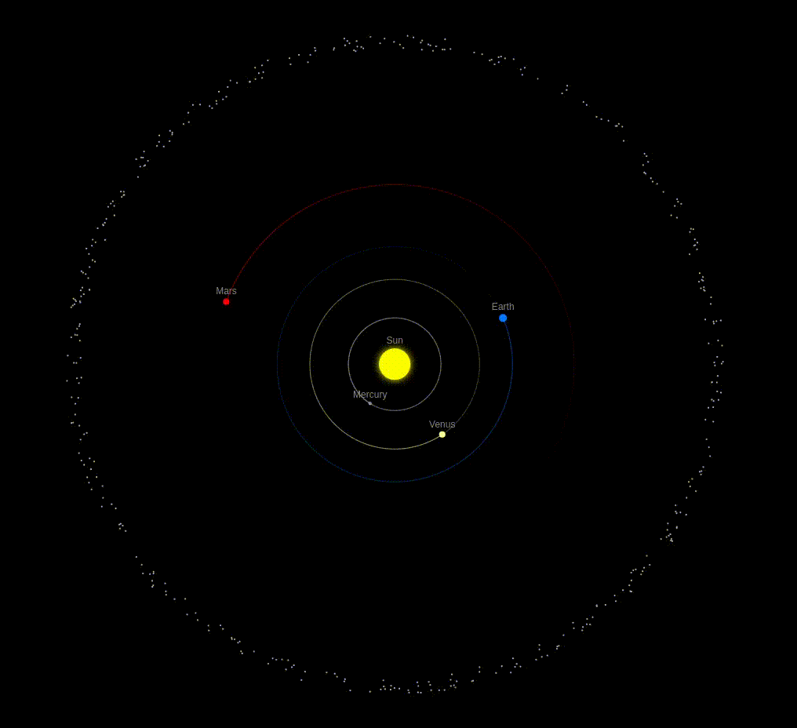
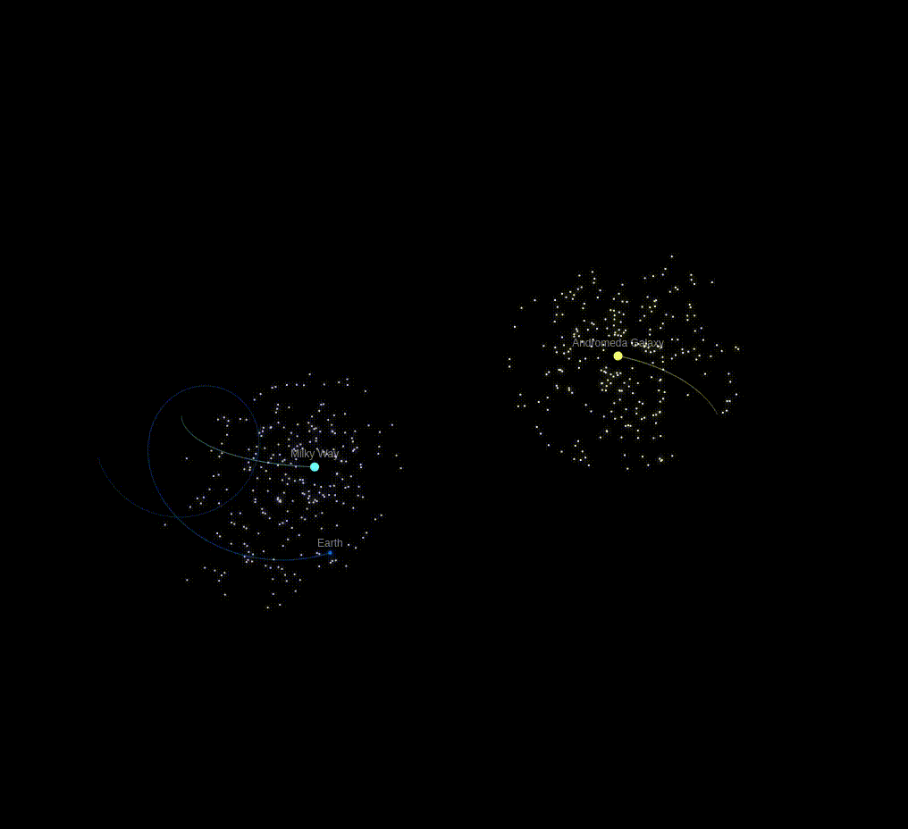
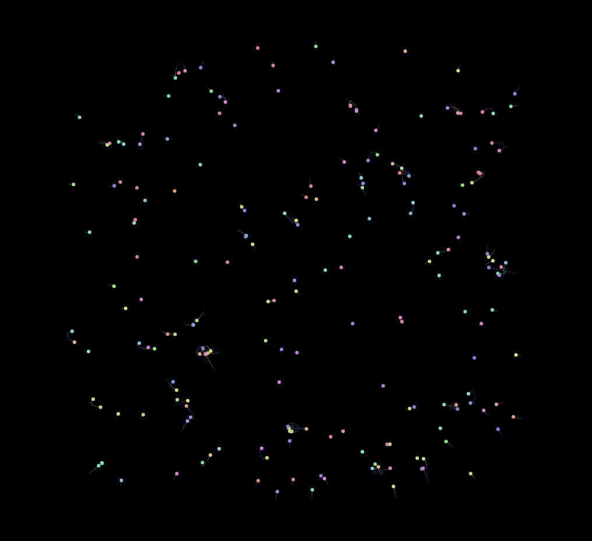

# Solar-JS: N-body solar system simulation written in JavaScript

## First steps

1. Launch a web server for the game using the command `npm run dev` in a shell
2. Open the game under <https://localhost:5173>

## Galaxy collision settings

Choose _Galaxy Collision_ in the drop-down at the bottom and click _Galaxy settings_ to open the settings panel.
The presets are the variations the simulation started out with: plain disks on a fast pass, disks with dark matter
halos, and mergers with halos, extended bulges and dynamical friction (with prograde or retrograde disks). Everything
can also be combined by hand: the rotation of each galaxy, a custom orbit given by its closest approach and
eccentricity, and the number of stars. Changes take effect immediately, and the settings are remembered in the
browser. The scene is calibrated to real units (kpc and Myr), and the _Earth_ is marked in the Milky Way.
